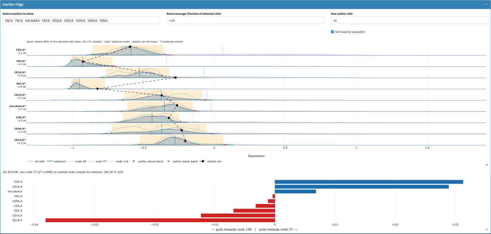
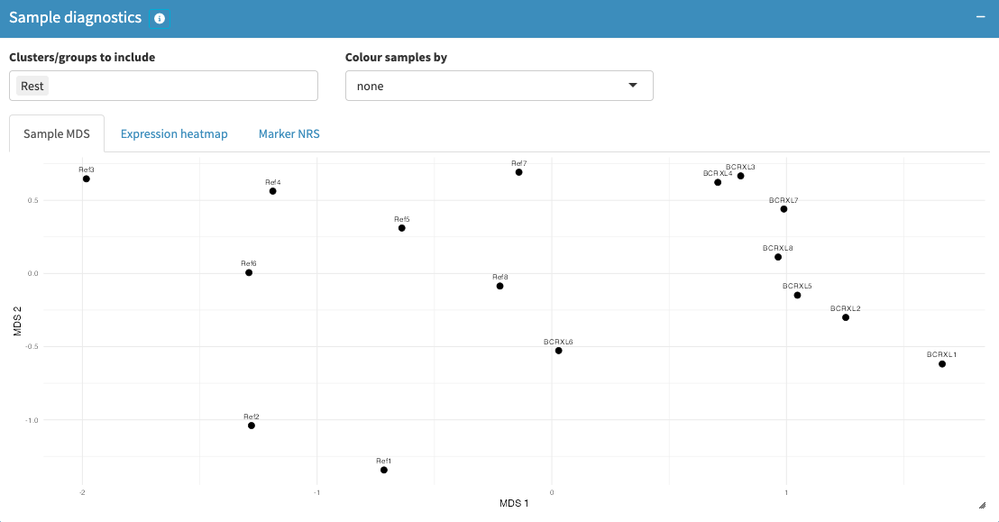
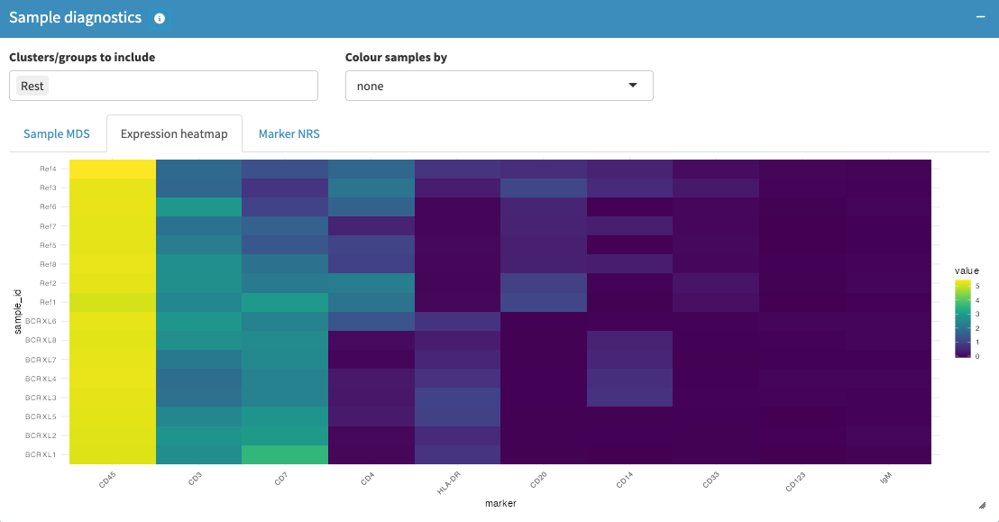
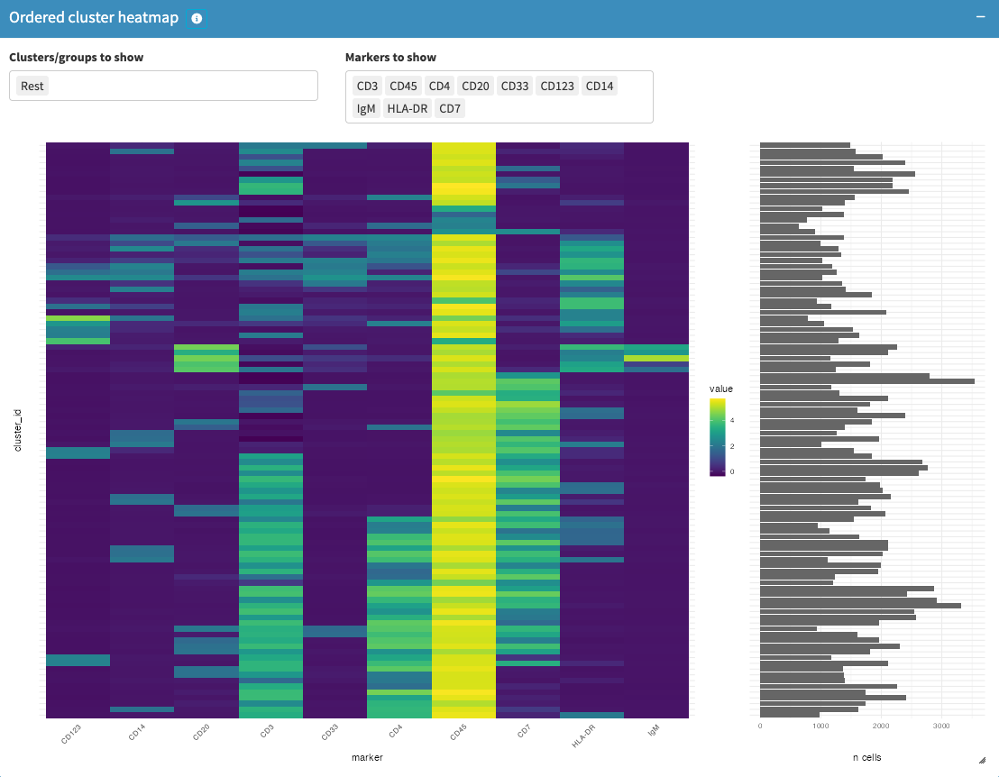
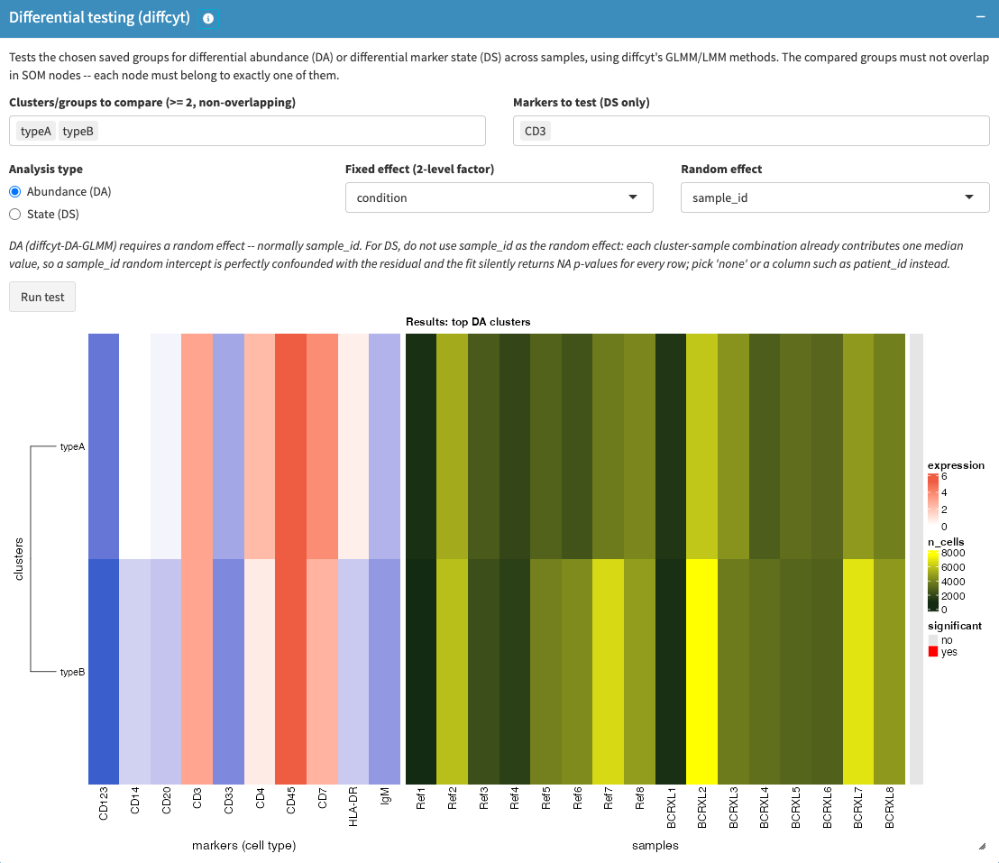
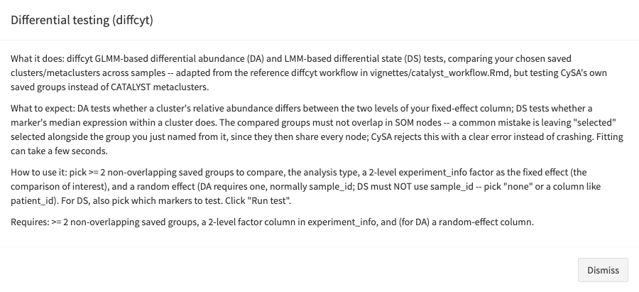

<!-- README.md is generated from README.Rmd. Please edit that file -->

```{r, include = FALSE}
knitr::opts_chunk$set(
  collapse = TRUE,
  comment = "#>",
  fig.path = "man/figures/README-",
  out.width = "100%"
)
```
# cysa

<!-- badges: start -->
[](https://bioconductor.org/checkResults/release/bioc-LATEST/cysa/)
[](https://bioconductor.org/checkResults/release/bioc-LATEST/cysa/)
[](https://bioconductor.org/packages/release/bioc/html/cysa.html)
[](https://bioconductor.org/packages/release/bioc/html/cysa.html)
<!-- badges: end -->


**CySA** provides an interactive Shiny application for selecting and
visualizing clusters from flow-cytometry data stored in
[`SingleCellExperiment`](https://bioconductor.org/packages/SingleCellExperiment)
objects. It is designed to work with SOM-based clustering outputs such
as those produced by
[FlowSOM](https://bioconductor.org/packages/FlowSOM) and curated by the
[CATALYST](https://bioconductor.org/packages/CATALYST) workflow.


## Installation

Install the development version from GitHub with:

``` r
if (!requireNamespace("BiocManager", quietly = TRUE))
    install.packages("BiocManager")

# After Bioconductor acceptance:
BiocManager::install("CySA")

# Development version:
BiocManager::install("baj12/CySA")
```

## Example

```{r example, eval = FALSE}
library(CySA)
library(SingleCellExperiment)

# sce should contain SOM_codes and SOM_stats in metadata(sce)
prepped <- prepClusterSelectorData(sce, total_cells_to_sample = 10000)

# Build the interactive selector app
app <- clusterSelector(
  sce = prepped$sce,
  sce_subsampled = prepped$sce_subsampled,
  dList = prepped$dList
)

# Launch the app
shiny::runApp(app)
```

## Screenshots

The app is organized into linked panels for gating, SOM-based
clustering, and downstream statistics.

### Manual gating and hierarchical clustering

Select cells directly on a 2D scatter plot, or select whole SOM clusters
from an interactive dendrogram:


### SOM node views and dimension reduction

SOM nodes can be explored in raw marker space or via t-SNE/UMAP/PCA
projections of the SOM code vectors, with the current selection
highlighted consistently across views:


### Marker-level exploration of a selection

All marker-pair combinations, per-node marker pie charts, and SOM
heatmaps help characterize the phenotype of a selected cluster:


### Outliers and node membership

The marker ridge box shows, per marker, the density of all cells and of
the selection, a band holding the central 99% of the selected cells, and
the selected cells outside that band as clickable dots. Clicking a dot
traces the cell across all markers and explains which clustering markers
keep it in its SOM node rather than in the nearest node outside the
selection:



### Statistics

Selected clusters can be compared between sample groups (e.g. control
vs. treated) with per-sample counts, percentages, and a two-sample
t-test:


### Sample diagnostics, cluster comparison, and differential testing

Three panels reproduce the sample-level QC and differential-testing
figures of the reference CATALYST/diffcyt CyTOF workflow inside CySA
itself (see `vignettes/catalyst_workflow.Rmd`), each restricted to a
chosen selection of saved clusters/metaclusters rather than always using
every cell:

**Sample diagnostics** -- a pseudobulk MDS plot of the samples and a
per-sample marker-expression heatmap (plus marker non-redundancy scores,
not shown), letting you see how samples separate within a chosen cell
population:




**Ordered cluster heatmap** -- a dendrogram-ordered marker-by-cluster
heatmap with a cell-count bar, for comparing marker profiles across a
chosen set of clusters/metaclusters and markers side by side:



**Differential testing (diffcyt)** -- GLMM-based differential abundance
and LMM-based differential state tests comparing chosen saved groups
across samples, with a results heatmap:



Every box in the dashboard also has an info button (the small circled
"i" next to its title) that opens a modal explaining what the box does,
what to expect, how to use it, and what it requires:



## Provenance

CySA is derived from the `clusterSelector` Shiny module originally
developed in `CyDa`. The code was subsequently extracted into a
standalone Bioconductor package and refactored with assistance from the
opencode AI coding assistant. All redistributed and AI-assisted code
remains under the package license (see `LICENSE`) and the maintainer is
responsible for its maintenance.

## Citation

If you use CySA in your research, please cite the package and the
relevant Bioconductor workflows.
