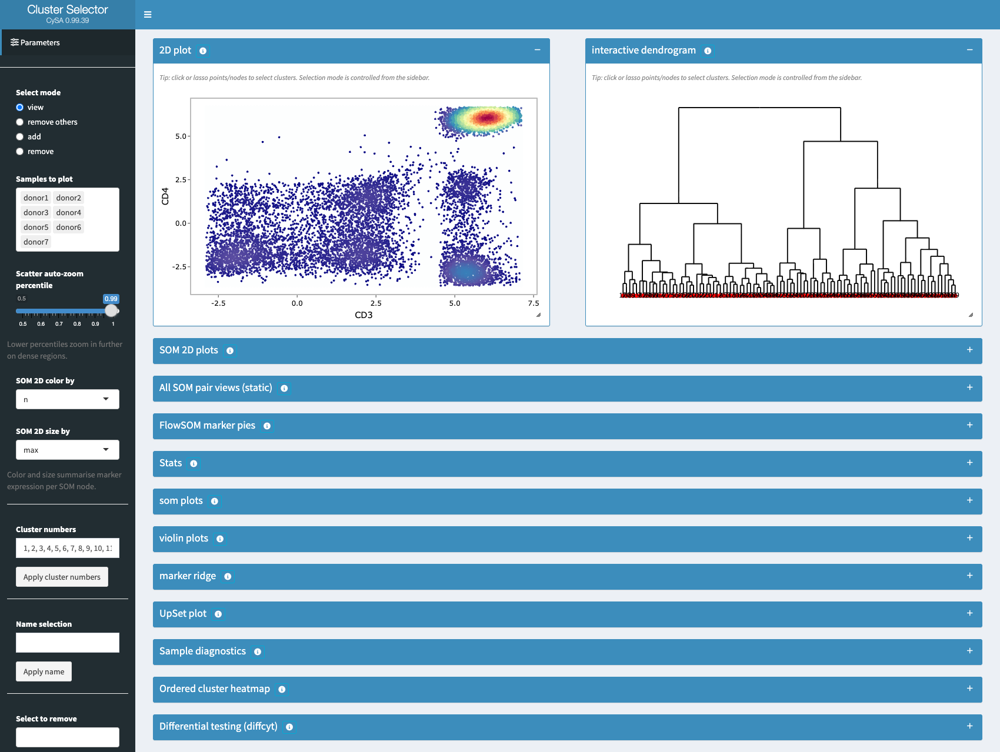
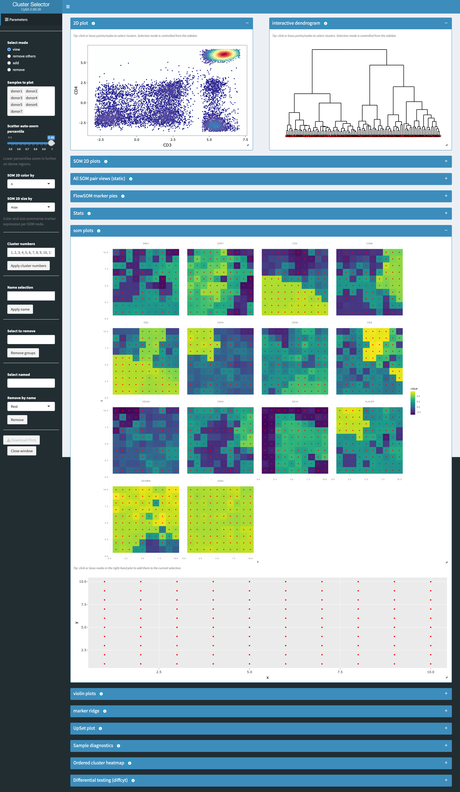
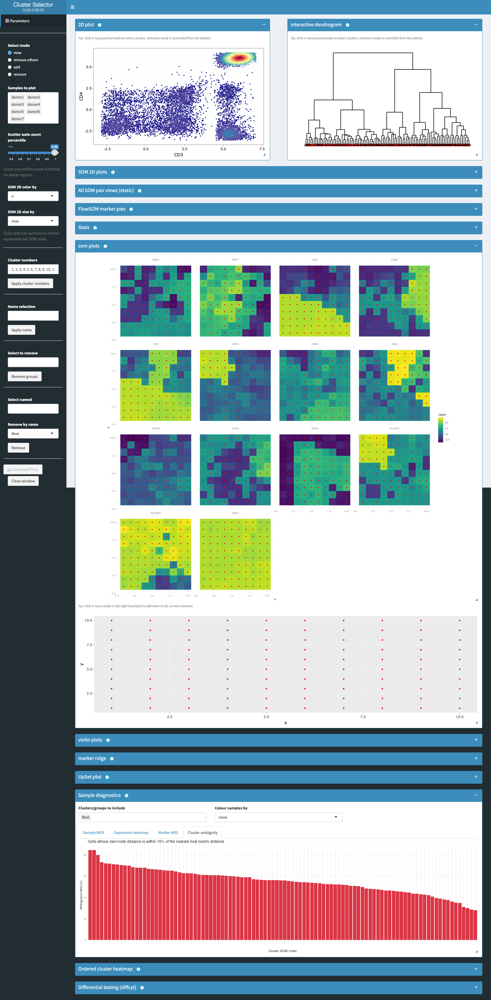
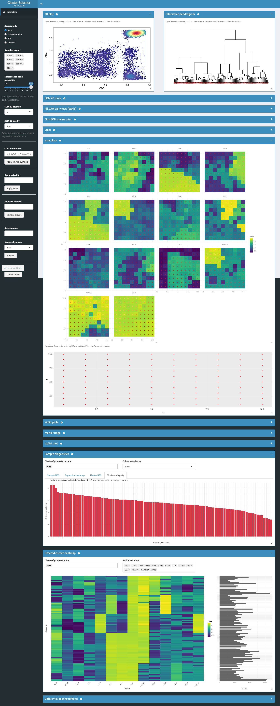

```{r setup, include = FALSE}
knitr::opts_chunk$set(
    collapse = TRUE, comment = "#>", message = FALSE, warning = FALSE,
    fig.width = 7, fig.height = 5
)
```

## Overview

This vignette is a self-contained case study for showing CySA's dashboard on
**real, high-dimensional spectral flow cytometry data**, with an independent
ground truth to check the clustering against.

The data are 56 FCS files (8 manually-gated immune populations x 7 healthy
donors, 24-marker panel) acquired on a **Cytek Aurora, a 5-laser spectral
flow cytometer** -- this is fluorescence-based flow cytometry read across
many spectral channels and unmixed. The samples are peripheral
blood: lymphocytes Ficoll-isolated from whole blood drawn from 7 healthy,
non-pregnant adult donors (de-identified discarded clinical material), per
the dataset's own documentation on Zenodo, published openly there (DOI
[10.5281/zenodo.15723074](https://zenodo.org/records/15723074), CC-BY-4.0) as
a companion dataset to Tursi *et al.* 2025, *"Automated descriptive cell type
naming in flow and mass cytometry with CytoPheno"*, Scientific Reports
15:26750. The files are organised one population/donor combination per FCS
file (e.g. `"B_cells_donor1.fcs"`), which gives a hidden ground-truth label
(`known_population`) for every cell -- the manual gating already done by the
original authors. We hide this label from FlowSOM and only use it afterwards
to score the unsupervised clustering, and to annotate the CySA dashboard
screenshots.

Scoring uses the **adjusted Rand index (ARI)**, computed throughout this
vignette with `mclust::adjustedRandIndex()`. The (unadjusted) Rand index is
the fraction of all cell pairs on which two clusterings agree (both put the
pair together, or both put it apart); the *adjustment* subtracts out the
agreement expected from chance grouping alone, so a random, uninformative
clustering scores ARI ~ 0 and a perfect match (up to arbitrary cluster
relabelling) scores ARI = 1. Here the two clusterings being compared are
always FlowSOM/CATALYST's unsupervised metaclusters (`meta12`, derived with
no knowledge of the labels) and `known_population`, the manual-gating
ground truth hidden from clustering -- so ARI is this vignette's single
number for "how well did unsupervised clustering recover the known cell
populations."

The download is plain HTTPS with no login or API key (unlike FlowRepository,
whose anonymous FCS download is gated behind an account), which is why this
dataset was chosen over the FlowRepository alternatives that were considered
first. Like `catalyst_workflow.Rmd`, this vignette depends on an external
download and real FlowSOM clustering (a few minutes of compute on ~725,000
cells), so it is excluded from the Bioconductor-submission vignette build
(see `.Rbuildignore`); run it directly with `rmarkdown::render()` or chunk by
chunk to validate the case study yourself.

```{r libs}
library(flowCore)
library(CATALYST)
library(SingleCellExperiment)
library(S4Vectors)
library(ggplot2)
library(viridis)
## Load the live package source rather than `library(CySA)`: this vignette
## is meant to validate in-development features (e.g. the cluster-ambiguity
## diagnostic), and an older *installed* copy of CySA would silently lack
## them. If this chunk is run outside the package tree, replace the path
## below with the CySA source checkout's root, or use library(CySA) once a
## matching version is installed.
if (requireNamespace("devtools", quietly = TRUE) &&
        file.exists("../DESCRIPTION")) {
    devtools::load_all("..", quiet = TRUE)
} else {
    library(CySA)
}
```

## Data download

All 56 FCS files plus the panel description (`Panel.pdf`) are fetched
directly from Zenodo's file API, one HTTPS GET per file, into a fresh,
otherwise-empty directory (FCS files are untrusted downloaded data, so they
are kept apart from this script and are never executed as code).

```{r download, eval = !dir.exists("spectral_fcs") || length(list.files("spectral_fcs", pattern = "\\.fcs$")) < 56}
record_id <- "15723074"
api_url <- paste0("https://zenodo.org/api/records/", record_id)
rec <- jsonlite::fromJSON(api_url, simplifyDataFrame = FALSE)
files_info <- rec$files

dir.create("spectral_fcs", showWarnings = FALSE)
for (f in files_info) {
    dest <- file.path("spectral_fcs", f$key)
    if (!file.exists(dest)) {
        download.file(f$links$self, dest, mode = "wb", quiet = TRUE)
    }
}
fcs_files <- list.files("spectral_fcs", pattern = "\\.fcs$", full.names = TRUE)
length(fcs_files)
```

```{r list-files}
fcs_files <- list.files("spectral_fcs", pattern = "\\.fcs$", full.names = TRUE)
stopifnot(length(fcs_files) == 56)
basename(fcs_files)[seq_len(6)]
```

## Building a single SingleCellExperiment

Each file name encodes `<population>_donor<N>.fcs`. The Zenodo record notes
that the fluorophores for CCR7 and HELIOS were swapped on donors 5-7; reading
every file by its FCS `$PnS` (antigen/description) field rather than by
physical channel name sidesteps that, since the `desc` for a given antigen is
consistent across all 56 files regardless of which physical channel it was
measured on for a particular donor.

This is verified directly against the raw files below, not just taken on the
Zenodo record's word: for donors 1-4, physical channel `$P10` (Alexa
Fluor 488-A) carries `$PnS = "HELIOS"` and `$P12` (Alexa Fluor 700-A)
carries `"CCR7"`; for donors 5-7 those same two physical channels are
swapped (`$P10` -> `"CCR7"`, `$P12` -> `"HELIOS"`). The `$PnS` value is what
tracks the antigen correctly across that swap, confirming that matching on
`desc` rather than channel name is both necessary and sufficient here.

```{r verify-ccr7-helios-swap}
check_desc <- function(fp) {
    ff <- read.FCS(fp, transformation = FALSE, truncate_max_range = FALSE)
    pd <- pData(parameters(ff))
    keep <- as.character(pd$desc) %in% c("CCR7", "HELIOS")
    data.frame(name = as.character(pd$name)[keep],
        desc = as.character(pd$desc)[keep], stringsAsFactors = FALSE)
}
swap_check <- lapply(
    c(donor1 = "spectral_fcs/B_cells_donor1.fcs",
        donor5 = "spectral_fcs/B_cells_donor5.fcs"),
    check_desc
)
swap_check
stopifnot(
    identical(swap_check$donor1$desc[swap_check$donor1$name == "Alexa Fluor 488-A"],
        "HELIOS"),
    identical(swap_check$donor5$desc[swap_check$donor5$name == "Alexa Fluor 488-A"],
        "CCR7")
)
```

```{r common-markers}
## The 24 markers present with a non-NA $PnS description in every one of
## the 56 files.
common_markers <- c(
    "CCR4", "GZMB", "HELIOS", "GNLY", "CCR7", "CD4", "CD56", "CD3", "CD19",
    "CD95", "CD8", "CD103", "CD16", "CD14", "CD69", "CCR6", "HLA-DR", "CD25",
    "CD45RA", "PD1", "CD39", "FOXP3", "TIGIT", "CD45"
)

parse_name <- function(fn) {
    base <- sub("\\.fcs$", "", basename(fn))
    donor <- as.integer(sub("_donor", "",
        regmatches(base, regexpr("_donor[0-9]+$", base))))
    pop <- gsub(" ", "_", sub("_donor[0-9]+$", "", base))
    list(pop = pop, donor = donor)
}
```

```{r build-flowset}
ffs <- list()
md_rows <- list()
for (fp in fcs_files) {
    info <- parse_name(fp)
    ff <- read.FCS(fp, transformation = FALSE, truncate_max_range = FALSE)
    pd <- pData(parameters(ff))
    idx <- match(common_markers, as.character(pd$desc))
    stopifnot(!anyNA(idx))
    m <- exprs(ff)[, idx, drop = FALSE]
    colnames(m) <- common_markers
    storage.mode(m) <- "double"
    fn <- paste0(info$pop, "_donor", info$donor)
    ffs[[fn]] <- flowFrame(m)
    md_rows[[fn]] <- data.frame(
        file_name = fn, sample_id = paste0("donor", info$donor),
        donor = paste0("donor", info$donor), known_population = info$pop,
        stringsAsFactors = FALSE
    )
}
fs <- as(ffs, "flowSet")
flowCore::sampleNames(fs) <- names(ffs)
md <- do.call(rbind, md_rows)
md <- md[match(names(ffs), md$file_name), ]
table(md$known_population)
```

Fourteen lineage ("type") markers define the FlowSOM grid; the remaining ten
activation/exhaustion ("state") markers are kept in the `SingleCellExperiment`
for visual inspection in CySA but are not used for clustering.

```{r panel}
state_markers <- c(
    "CD69", "CD25", "CD39", "PD1", "TIGIT", "FOXP3", "GZMB", "CCR4", "CCR6",
    "HELIOS"
)
panel <- data.frame(
    fcs_colname = common_markers, antigen = common_markers,
    marker_class = ifelse(common_markers %in% state_markers, "state", "type"),
    stringsAsFactors = FALSE
)
table(panel$marker_class)
```

Tursi et al. (the Zenodo dataset's companion paper) report hand-tuned,
per-marker arcsinh cofactors for eight of the lineage markers, chosen by
inspecting density plots across 15 candidate cofactors (250-50,000) for
each marker: 10,000 for CD14, 1,000 for CD19, 3,000 for CD3, 2,000 for
CD56, 4,000 for CD45RA, 3,000 for CD8, 5,000 for CD4, and 6,000 for CCR7.
Neither the paper nor its supplement gives a value for the remaining 16
markers; for those we fall back to 6,000, the flat default the same group's
own CytoPheno tool recommends for spectral flow cytometry generally (its
in-app help text: "6000 for spectral flow cytometry", vs. 15 for
conventional flow and 5 for mass cytometry) -- a flat 150, which is a
conventional-flow convention, is not supported by anything this group did
with this instrument.

```{r prep-data}
spectral_cofactors <- setNames(rep(6000, length(common_markers)), common_markers)
spectral_cofactors[c("CD14", "CD19", "CD3", "CD56", "CD45RA", "CD8", "CD4", "CCR7")] <-
    c(10000, 1000, 3000, 2000, 4000, 3000, 5000, 6000)

sce <- prepData(fs, panel, md, features = panel$fcs_colname,
    transform = TRUE, cofactor = spectral_cofactors, FACS = TRUE,
    md_cols = list(file = "file_name", id = "sample_id",
        factors = c("donor", "known_population")))
dim(sce)
length(type_markers(sce))
length(state_markers(sce))
sce_prepped <- sce  # kept un-clustered; reused later for the parameter sweep
```

## FlowSOM clustering (ground truth hidden)

`known_population` is carried as a `colData` column but never passed to
`cluster()` -- it is only used afterwards, to score the clustering.

Before clustering, it is worth looking at the actual scale of what the SOM
will see: the arcsinh-transformed (`exprs` assay) value range, mean, and SD
for each of the 14 type markers that define the grid. A SOM trained on
Euclidean distance implicitly treats a marker with a wider spread as more
important, so a marker that is an outlier on scale alone is worth noticing
before, not after, interpreting the clustering.

```{r marker-ranges}
type_m <- type_markers(sce)
marker_ranges <- t(apply(assay(sce, "exprs")[type_m, ], 1, function(v) {
    c(min = min(v), max = max(v), mean = mean(v), sd = sd(v))
}))
marker_ranges <- as.data.frame(round(marker_ranges, 2))
marker_ranges[order(-marker_ranges$sd), ]
```

```{r marker-means, fig.width = 9, fig.height = 5}

## Same marker order as the SD plot
per_sample$marker <- factor(per_sample$marker, levels = levels(per_sample$marker))

ggplot(per_sample, aes(x = marker, y = mean)) +
    geom_boxplot(outlier.shape = NA, fill = "grey90") +
    geom_jitter(aes(colour = sample_id), width = 0.15, size = 2) +
    labs(x = "Type marker", y = "Per-sample mean",
        colour = "Sample",
        title = "Per-sample mean of arcsinh-transformed expression") +
    theme_minimal() +
    theme(axis.text.x = element_text(angle = 45, hjust = 1))
per_sample$mean_centered <- per_sample$mean -
    ave(per_sample$mean, per_sample$marker)

ggplot(per_sample, aes(x = marker, y = mean_centered, colour = sample_id)) +
    geom_hline(yintercept = 0, linewidth = 0.3) +
    geom_jitter(width = 0.15, size = 2) +
    labs(x = "Type marker", y = "Per-sample mean minus marker's mean across donors",
        colour = "Sample",
        title = "Donor offsets in mean expression") +
    theme_minimal() +
    theme(axis.text.x = element_text(angle = 45, hjust = 1))

ex  <- assay(sce, "exprs")[type_m, ]
pop <- factor(sce$known_population)

marker_info <- t(apply(ex, 1, function(v) {
    gm      <- tapply(v, pop, mean)
    gn      <- as.numeric(table(pop))
    between <- sum(gn * (gm - mean(v))^2) / length(v)
    total   <- mean((v - mean(v))^2)
    within  <- sum(tapply(v, pop, function(z) sum((z - mean(z))^2))) / length(v)
    c(sd = sqrt(total), eta2 = between / total, within_sd = sqrt(within))
}))
marker_info <- as.data.frame(round(marker_info, 3))
marker_info[order(-marker_info$eta2), ]

ggplot(marker_info, aes(x = sd, y = eta2, label = rownames(marker_info))) +
    geom_point() + ggrepel::geom_text_repel() +
    labs(x = "Total SD (current SOM weight)",
         y = "Fraction of variance explained by known population") +
    theme_minimal()
```


The pooled numbers above can hide donor-to-donor differences in scale, which
matter here because the SOM is trained on all seven donors pooled together
without any per-donor correction. The boxplot below shows, for each marker,
the spread of its per-sample SD across the 7 donors; a marker whose SD
varies a lot from donor to donor (a tall box/whiskers) is one where a single
donor's spread could disproportionately drive that marker's contribution to
the pooled Euclidean distance.

```{r marker-ranges-per-sample, fig.width = 9, fig.height = 5}
exprs_m <- assay(sce, "exprs")[type_m, ]
sample_vec <- sce$sample_id
per_sample <- do.call(rbind, lapply(type_m, function(m) {
    agg <- tapply(exprs_m[m, ], sample_vec, function(v) c(mean = mean(v), sd = sd(v)))
    data.frame(marker = m, sample_id = names(agg),
        mean = vapply(agg, `[`, numeric(1), "mean"),
        sd = vapply(agg, `[`, numeric(1), "sd"))
}))
per_sample$marker <- factor(per_sample$marker,
    levels = type_m[order(tapply(per_sample$sd, per_sample$marker, median),
        decreasing = TRUE)])

ggplot(per_sample, aes(x = marker, y = sd)) +
    geom_boxplot(outlier.shape = NA, fill = "grey90") +
    geom_jitter(aes(colour = sample_id), width = 0.15, size = 2) +
    labs(x = "Type marker", y = "Per-sample SD",
        colour = "Sample",
        title = "Per-sample SD of arcsinh-transformed expression") +
    theme_minimal() +
    theme(axis.text.x = element_text(angle = 45, hjust = 1))
```

```{r cluster}
set.seed(1234)
sce <- cluster(sce, features = type_markers(sce),
    xdim = 10, ydim = 10, maxK = 12, seed = 1234, verbose = FALSE)
```

```{r ari}
meta12 <- cluster_ids(sce, "meta12")
ari <- mclust::adjustedRandIndex(meta12, sce$known_population)
cat("Adjusted Rand index (meta12 vs. known_population):",
    round(ari, 3), "\n")
confusion <- table(known = sce$known_population, meta12 = meta12)
confusion
```

```{r fig-confusion-heatmap, fig.width = 8, fig.height = 5}
## Row-normalized (per known population) so each row sums to 1 -- this is
## the more readable view when, as here, the known populations differ
## hugely in cell count (e.g. far more T cells than NK cells).
confusion_prop <- confusion / rowSums(confusion)
confusion_df <- as.data.frame(confusion_prop)
confusion_df$meta12 <- factor(confusion_df$meta12,
    levels = as.character(sort(as.integer(unique(confusion_df$meta12)))))

ggplot(confusion_df, aes(x = meta12, y = known, fill = Freq)) +
    geom_tile(colour = "white") +
    geom_text(aes(label = ifelse(Freq > 0.01, scales::percent(Freq, accuracy = 1), "")),
        size = 3, colour = "black") +
    scale_fill_viridis(name = "Fraction of\nknown population", limits = c(0, 1)) +
    labs(x = "SOM metacluster (meta12)", y = "Known population",
        title = "Known population vs. unsupervised metacluster assignment") +
    theme_minimal() +
    theme(panel.grid = element_blank())
```

An ARI of `r round(ari, 2)` is a strong recovery for a fully unsupervised
10x10 SOM run on real spectral data, using the paper's own per-marker
cofactors: B cells and NK cells typically separate almost perfectly (each
lands on one metacluster at or near 100%), while naive/effector-memory/TEMRA
CD8 T-cell subsets still show some cross-cluster mixing in the heatmap
above -- a real, biologically-expected differentiation continuum rather than
a clustering failure. This is exactly the kind of structure the next
section is built to show visually, cluster by cluster.

### Is `cluster()`'s SOM actually FlowSOM?

`cluster()` is a CATALYST function, which raises a fair question: is the SOM
itself really FlowSOM, or a CATALYST reimplementation of it? Reading
`cluster()`'s source settles the grid-building half unambiguously -- its body
is literally

```r
fsom <- ReadInput(flowFrame(t(assay(x, "exprs"))))
som <- BuildSOM(fsom, colsToUse = features, silent = TRUE, xdim = xdim, ydim = ydim)
```

i.e. `FlowSOM::ReadInput()` and `FlowSOM::BuildSOM()`, called directly. The
100-node 10x10 grid above was trained by FlowSOM's own code, not a
lookalike.

The second half of what "FlowSOM" usually means -- collapsing those 100 SOM
nodes into a handful of metaclusters -- is where `cluster()` quietly departs
from FlowSOM: it hands the SOM codes to
`ConsensusClusterPlus::ConsensusClusterPlus()` instead of to FlowSOM's own
`metaClustering_consensus()`. Both are consensus-clustering approaches, but
they are different implementations and are not guaranteed to agree.

```{r metaclustering-load}
metaclustering_compare <- readRDS("support/metaclustering/metaclustering_compare.rds")
metaclustering_compare
```

Re-running the metaclustering step on the *identical* SOM codes and mapping
from the chunk above -- changing only ConsensusClusterPlus for
`FlowSOM::metaClustering_consensus(som$map$codes, k = 12, seed = 1234)` --
gives an ARI of `r round(metaclustering_compare$ari_meta12[2], 3)`, against
`r round(metaclustering_compare$ari_meta12[1], 3)` for CATALYST's
ConsensusClusterPlus default (reproduced here exactly, confirming both the
SOM step and this comparison are deterministic). FlowSOM's own metaclustering
is marginally *better* on this dataset, not worse -- so there is no accuracy
cost to CATALYST's substitution here, but the two are measurably different
algorithms, not interchangeable labels for the same computation, and the
rest of this vignette uses CATALYST's ConsensusClusterPlus path throughout
(via `cluster()`) for consistency with the baseline above.

## How much does the cofactor choice matter?

The per-marker cofactors above were a documentation exercise -- transcribed
from the paper and its supplement, not independently derived. It is worth
checking empirically whether getting this parameter right actually matters,
and if so, over what range a *single flat* cofactor (the simplest choice
available to someone with no per-marker guidance at all) gives acceptable
results. The sweep below re-runs `prepData()` + `cluster()` from scratch at
each of 13 flat cofactor values spanning the paper's own tested range
(250-50,000, extended slightly on both ends), using only the 14 type
markers and the same fixed 10x10 grid as everywhere else in this vignette,
and scores each run the same way (ARI against `known_population`, raw-node
ambiguity).

```{r cofactor-sweep}
run_flat_cofactor <- function(cf) {
    sce_cf <- prepData(fs, panel, md, features = panel$fcs_colname,
        transform = TRUE, cofactor = cf, FACS = TRUE,
        md_cols = list(file = "file_name", id = "sample_id",
            factors = c("donor", "known_population")))
    tm <- type_markers(sce_cf)
    set.seed(1234)
    sce_cf <- cluster(sce_cf, features = tm, xdim = 10, ydim = 10,
        maxK = 12, seed = 1234, verbose = FALSE)
    ari_cf <- mclust::adjustedRandIndex(
        cluster_ids(sce_cf, "meta12"), sce_cf$known_population)

    cid_cf <- as.integer(as.character(cluster_ids(sce_cf, "som100")))
    codes_cf <- metadata(sce_cf)$SOM_codes[, tm]
    expr_cf <- t(SummarizedExperiment::assay(sce_cf, "exprs")[tm, ])
    sq_cells <- matrixStats::rowSums2(expr_cf^2)
    sq_codes <- matrixStats::rowSums2(codes_cf^2)
    dist2 <- outer(sq_cells, sq_codes, "+") - 2 * (expr_cf %*% t(codes_cf))
    n <- nrow(dist2)
    own_dist2 <- dist2[cbind(seq_len(n), cid_cf)]
    dist2[cbind(seq_len(n), cid_cf)] <- Inf
    rival_dist2 <- matrixStats::rowMins(dist2)
    ratio_cf <- sqrt(pmax(own_dist2, 0)) / sqrt(pmax(rival_dist2, 0))

    data.frame(cofactor = cf, ari_meta12 = ari_cf,
        pct_ambiguous = 100 * mean(ratio_cf > 0.9))
}

cofactor_grid <- c(50, 100, 150, 250, 500, 1000, 2000, 3000, 6000, 10000,
    20000, 50000, 100000)
cofactor_sweep <- do.call(rbind, lapply(cofactor_grid, run_flat_cofactor))
cofactor_sweep
```

```{r fig-cofactor-sweep, fig.width = 8, fig.height = 4.5}
best_cf <- cofactor_sweep$cofactor[which.max(cofactor_sweep$ari_meta12)]

cf_long <- reshape2::melt(cofactor_sweep, id.vars = "cofactor")
cf_long$variable <- factor(cf_long$variable, labels = c(
    "ARI vs. known population (meta12)", "Ambiguous cells (%, raw SOM node)"))

ggplot(cf_long, aes(x = cofactor, y = value)) +
    annotate("rect", xmin = 1000, xmax = 10000, ymin = -Inf, ymax = Inf,
        fill = "#2a9d8f", alpha = 0.08) +
    geom_vline(xintercept = 150, colour = "#dc3545", linetype = "dashed") +
    geom_vline(xintercept = 6000, colour = "#264653", linetype = "dashed") +
    geom_line(colour = "grey50") +
    geom_point(size = 2.5, colour = "#264653") +
    scale_x_log10(breaks = cofactor_grid,
        labels = scales::label_number(big.mark = ",")) +
    facet_wrap(~variable, scales = "free_y", ncol = 1) +
    labs(
        x = "Flat arcsinh cofactor (log scale)", y = NULL,
        title = "Clustering quality across the paper's own tested cofactor range",
        subtitle = paste0(
            "Shaded band: paper's per-marker range (1,000-10,000). ",
            "Red line: this vignette's original wrong default (150). ",
            "Dark line: the flat fallback actually used (6,000).")
    ) +
    theme_minimal() +
    theme(axis.text.x = element_text(angle = 45, hjust = 1))
```

The relationship is a clean inverted U, not a threshold or a plateau: ARI
rises from `r round(cofactor_sweep$ari_meta12[cofactor_sweep$cofactor == 50], 2)`
at cofactor 50 to a peak of `r round(max(cofactor_sweep$ari_meta12), 2)` at
cofactor `r best_cf`, then falls back to
`r round(cofactor_sweep$ari_meta12[cofactor_sweep$cofactor == 100000], 2)`
at cofactor 100,000 -- a round trip from poor to excellent back to poor
over three orders of magnitude. The mechanism is the same on both sides,
just in opposite directions: arcsinh(x / cofactor) is approximately linear
for x well below the cofactor and approximately logarithmic for x well
above it, so the cofactor sets *where* that transition happens on the raw
intensity scale. Too small a cofactor (50-150) pushes almost the entire
dynamic range into the compressed, logarithmic regime, flattening real
differences between dim and intermediate-expressing cells into noise --
this vignette's original, unexamined default of 150 sits here, at
ARI `r round(cofactor_sweep$ari_meta12[cofactor_sweep$cofactor == 150], 2)`,
clearly on the losing side of the curve. Too large a cofactor (50,000+)
keeps most of the range nearly linear and lets a handful of very bright
events dominate the Euclidean distance FlowSOM clusters on, which is just
as damaging in the other direction. The paper's actual per-marker range
(1,000-10,000, shaded band above) sits squarely inside the high-ARI plateau
in this flat-cofactor sweep too, and the flat fallback this vignette uses
for markers without a published value (6,000) lands
at `r round(cofactor_sweep$ari_meta12[cofactor_sweep$cofactor == 6000], 2)`
-- comfortably on the plateau, even if not exactly at its peak
(cofactor `r best_cf`). Ambiguity does *not* mirror the ARI curve: it rises
with ARI on the low-cofactor side (peaking at cofactor
`r cofactor_sweep$cofactor[which.max(cofactor_sweep$pct_ambiguous)]`, just
past where ARI is still climbing), for the same reason the grid-size sweep
later in this vignette shows ARI and ambiguity rising together -- a cofactor
good enough to start resolving real structure is also good enough to make
genuinely continuous boundaries visible as ambiguous, rather than silently
merging them away. But on the high-cofactor side, where ARI collapses back
down, ambiguity keeps falling instead of rising back up: once the cofactor
is large enough to leave the data nearly linear and dominated by a few
bright events, most cells end up roughly equidistant from many nodes in a
degenerate, poorly structured space, which lowers the *own-vs-rival
distance ratio* this metric uses even though the resulting clustering is
worse by every other measure. Ambiguity alone, without ARI or a ground
truth to check it against, would have been actively misleading at the
high-cofactor end of this sweep.

This is also a direct, practical answer to "how was 6,000 chosen for the
sixteen markers the paper doesn't cover": it is not optimal
(cofactor `r best_cf` is, by
`r round(max(cofactor_sweep$ari_meta12) - cofactor_sweep$ari_meta12[cofactor_sweep$cofactor == 6000], 3)`
ARI points), but it is safely inside the plateau rather than a guess that
happens to work. Anyone adapting this pipeline to a different panel or
instrument should not assume either endpoint of this plateau transfers;
running a sweep like this one -- cheap, at roughly 19 seconds per
configuration here -- against whatever ground truth or domain knowledge is
available is a more reliable starting point than copying a cofactor from a
different dataset's methods section.

## Does an automated, per-donor, per-marker cofactor estimator do better?

The sweep above answers "which flat cofactor works best here," but it still
only tests values a human chose to test. `CyEt` ("Cytometry Ensemble
Transformation"), a companion Bioconductor-track package from the same
group as CySA, automates per-marker cofactor selection without any of that
human input: for each marker it grid-searches arcsinh cofactors
`b = 1.1^k` and window widths, scores every `(b, window)` combination by
the Shapiro-Wilk normality statistic of the transformed, windowed data, and
reports the `b` that makes that marker's own distribution look most
Gaussian within its best-scoring window. Critically, this optimization
target has nothing to do with clustering or with any ground truth -- it is
purely a property of each marker's own univariate distribution. That makes
it a genuinely independent check on the cofactors used above: does
"most normal-looking" line up with "clusters best"?

CyEt is a per-*sample* cofactor estimator: `optimizeBvalueVector()` takes
one marker's values from one set of cells and nothing else. Since the 7
donors here were stained and acquired separately, the correct granularity
is **per donor *and* per marker** -- 7 x 24 = 168 independent
`optimizeBvalueVector()` calls, one per donor-marker combination, each
using only that donor's own cells. Pooling cells across donors first (as
`CyEt::optimizeBvalueMatrix()` does, with no sample- or donor-level
grouping of its own) would hide any donor-to-donor heterogeneity in each
marker's best-fitting cofactor and average over it instead, so this
vignette does not use `optimizeBvalueMatrix()` at all.

Run at full scale (each donor's ~100,000 cells, unsampled) this is far
too slow: timing a single donor-marker combination this way took
**63 minutes**, because `optimizeBvalueVector()`'s weighted resampling
step scales with input size, and a single donor's cell count is actually
*larger* than the 40,000-cell pooled subsample used above (spread across
all 7 donors). Subsampling each donor to 6,000 cells first -- comparable
to that same pooled budget split 7 ways -- cuts this to 82 seconds with an
*identical* result (verified directly), making the full 168-combination
grid tractable: **57.5 minutes** total on 8 cores.

```{r cyet-per-donor-run, eval = FALSE}
## Not evaluated when building this vignette (~1 hour on 8 cores); cached
## result loaded below (support/cyet/cyet_per_donor_resolved.rds).
combos <- expand.grid(donor = seq_along(unique(sce$donor)),
    marker = panel$fcs_colname, stringsAsFactors = FALSE)
run_one <- function(i) {
    donor <- combos$donor[i]; marker <- combos$marker[i]
    x <- raw_mat[md$donor_vec == donor, marker]
    x <- x[sample.int(length(x), min(6000, length(x)))]
    res <- optimizeBvalueVector(x, b_test_range = -20:220,
        seed = 1000 * donor + match(marker, panel$fcs_colname))
    data.frame(donor = donor, marker = marker, b = res$optimal_b,
        boundary_flag = res$boundary_flag)
}
per_donor_cyet <- do.call(rbind, parallel::mclapply(seq_len(nrow(combos)), run_one, mc.cores = 8))
```

```{r cyet-per-donor-load, fig.width = 8, fig.height = 6}
per_donor_cyet <- readRDS("support/cyet/cyet_per_donor_resolved.rds")
rownames(per_donor_cyet) <- NULL
cat(sum(per_donor_cyet$boundary_flag), "of", nrow(per_donor_cyet),
    "donor-marker combinations hit the boundary artifact:\n")
per_donor_cyet[per_donor_cyet$boundary_flag, c("donor", "marker", "b")]

ggplot(per_donor_cyet, aes(x = factor(donor), y = marker, fill = b)) +
    geom_tile(colour = "white") +
    scale_fill_viridis(trans = "log10", name = "CyEt b\n(per donor)") +
    labs(x = "Donor", y = NULL,
        title = "Per-donor, per-marker CyEt cofactors (pre-boundary-resolution)") +
    theme_minimal()
```

Running CyEt correctly, per donor, surfaces something the pooled run
hid completely: **pooling was masking real donor-to-donor heterogeneity**,
and it was also masking a *second* boundary artifact. CD45 hits the exact
same `1.1^-20` floor seen earlier, but now on 4 of the 7 donors (1, 4, 5,
and 7) rather than uniformly -- the other 3 donors (2, 3, 6) resolve to
enormous, consistent values (~2-2.6x10^5). GZMB, which looked
unremarkable in the pooled run (b ~ 1,272), turns out to hit that same
floor for donor 4 specifically. Both are resolved the same way as CD45
was resolved earlier: each boundary-flagged donor's value is replaced
with that marker's median value among its own *non*-boundary donors.

```{r fig-cyet-per-donor-resolved, fig.width = 8, fig.height = 6}
ggplot(per_donor_cyet, aes(x = factor(donor), y = marker, fill = b_resolved)) +
    geom_tile(colour = "white") +
    geom_text(data = per_donor_cyet[per_donor_cyet$boundary_flag, ],
        aes(label = "*"), colour = "white", size = 5) +
    scale_fill_viridis(trans = "log10", name = "CyEt b\n(resolved)") +
    labs(x = "Donor", y = NULL,
        title = "Per-donor, per-marker CyEt cofactors (boundary cases resolved, starred)") +
    theme_minimal()
```

Setting the two boundary artifacts aside, the donor-to-donor spread is
real and substantial for several markers -- CD3 ranges
`r round(min(per_donor_cyet$b_resolved[per_donor_cyet$marker == "CD3"]), 0)`-`r round(max(per_donor_cyet$b_resolved[per_donor_cyet$marker == "CD3"]), 0)`
across donors, CD14
`r round(min(per_donor_cyet$b_resolved[per_donor_cyet$marker == "CD14"]), 0)`-`r round(max(per_donor_cyet$b_resolved[per_donor_cyet$marker == "CD14"]), 0)`
-- which is exactly the donor-level variation a single pooled cofactor, or
this vignette's own single global per-marker cofactor, necessarily
averages away. Whether *using* that per-donor variation (transforming
each donor with its own cofactor, then explicitly re-aligning the donors)
helps or hurts clustering is a different question, taken up next.

## The full pipeline: per-donor CyEt, then cyCombine, then scale

The natural way to *use* the per-donor cofactor heterogeneity just found,
rather than merely document it, is the standard three-step recipe: transform
each donor with its own per-marker cofactor, explicitly realign the donors
(since independently-chosen per-donor transforms are themselves a new
source of cross-donor mismatch on top of whatever was already there), then
scale, all before FlowSOM. We test this with
[`cyCombine`](https://github.com/biosurf/cyCombine) (Pedersen *et al.*
2022, *Nature Communications* 13:391) for the realignment step, which runs
[`sva::ComBat`](https://bioconductor.org/packages/sva/) per internal
SOM-defined cell-state group rather than once globally, so the correction
cannot flatten away real between-population differences that happen to be
unevenly distributed across donors. `cyCombine` is not on CRAN or
Bioconductor (install with `remotes::install_github("biosurf/cyCombine")`),
so it is **not** added to this package's `Suggests:` -- unlike CyEt and
this vignette's other Suggests, doing so would not resolve on a standard
Bioconductor build machine. The code below is real and was run to produce
the cached numbers that follow, but is not re-run when this vignette is
built.

```{r cycombine-correct, eval = FALSE}
library(cyCombine)

## Step 1: arcsinh-transform each donor's cells with THAT donor's own
## per-marker CyEt cofactor (cyet_per_donor_resolved from the previous
## section), not a single shared value.
all_m <- c(type_markers(sce_prepped), state_markers(sce_prepped))
b_lookup <- setNames(per_donor_cyet$b_resolved,
    paste(per_donor_cyet$donor, per_donor_cyet$marker))
transformed <- raw_mat[, all_m]
for (dn in seq_along(unique(sce_prepped$donor))) {
    rows <- md$donor_vec == dn
    for (m in all_m) transformed[rows, m] <- asinh(raw_mat[rows, m] / b_lookup[paste(dn, m)])
}

## Step 2: cyCombine realigns the per-donor-transformed data across donors.
expr_df <- as.data.frame(transformed)
expr_df$batch <- sce_prepped$donor
expr_df$id <- seq_len(nrow(expr_df))
set.seed(1234)
corrected <- batch_correct(
    expr_df, markers = all_m, label = NULL,  # label = NULL: cyCombine
    xdim = 8, ydim = 8, seed = 1234,         # builds its own internal SOM
    norm_method = "scale", method = "ComBat" # to group cells before ComBat
)
corrected <- corrected[order(corrected$id), ]
corrected_mat <- as.matrix(corrected[, all_m])

## Step 3: the explicit "and then scale" step -- a separate z-score per
## marker, across all cells and donors, applied to the ComBat-corrected
## values (cyCombine's own norm_method = "scale" above only feeds its
## internal grouping SOM, not the values it returns).
scaled_mat <- scale(corrected_mat)

sce_cc <- sce_prepped
assay(sce_cc, "exprs") <- t(scaled_mat[, rownames(sce_cc)])
sce_cc <- cluster(sce_cc, features = type_markers(sce_cc),
    xdim = 10, ydim = 10, maxK = 12, seed = 1234, verbose = FALSE)
mclust::adjustedRandIndex(cluster_ids(sce_cc, "meta12"), sce_cc$known_population)
```

```{r cycombine-load}
cycombine_ari <- readRDS("support/cycombine/cycombine_per_donor_compare.rds")
rownames(cycombine_ari) <- NULL
cycombine_ari
```

```{r fig-cycombine-compare, fig.width = 7, fig.height = 4}
cycombine_ari$config <- factor(cycombine_ari$config, levels = rev(cycombine_ari$config))
ggplot(cycombine_ari, aes(x = config, y = ari_meta12)) +
    geom_col(fill = "steelblue") +
    geom_text(aes(label = round(ari_meta12, 3)), hjust = -0.1) +
    scale_y_continuous(limits = c(0, 1)) +
    coord_flip() +
    labs(x = NULL, y = "ARI (meta12 vs. known_population)",
        title = "Per-donor CyEt -> cyCombine -> scale, before FlowSOM: does it help?") +
    theme_minimal()
```

It does not, at any step of the pipeline. Per-donor CyEt transformation
*alone* -- before any attempt to realign the donors -- drops ARI to
`r round(cycombine_ari$ari_meta12[cycombine_ari$config == "Per-donor CyEt transform only"], 3)`,
noticeably worse even than the already-disappointing *pooled* CyEt result
from the previous section (0.87-0.89): giving each donor its own
independently-chosen, normality-optimal cofactor does not just inherit the
pooled run's normality-vs-separability mismatch, it adds a second,
independent source of cross-donor misalignment on top, since two donors'
"most normal-looking" cofactors for the same marker can differ several-fold
(CD3: `r round(min(per_donor_cyet$b_resolved[per_donor_cyet$marker == "CD3"]), 0)`-`r round(max(per_donor_cyet$b_resolved[per_donor_cyet$marker == "CD3"]), 0)`)
with nothing to keep the resulting transformed scales consistent across
donors.

cyCombine's realignment step recovers a substantial part of that self-inflicted
damage -- ARI rises to
`r round(cycombine_ari$ari_meta12[cycombine_ari$config == "Per-donor CyEt + cyCombine"], 3)`,
consistent with much of what per-donor CyEt broke being exactly the kind of
cross-donor distributional mismatch ComBat is designed to remove -- but
this still falls well short of this vignette's simple baseline (a single,
shared per-marker cofactor, no batch correction at all):
`r round(cycombine_ari$ari_meta12[cycombine_ari$config == "Baseline (paper cofactors, global)"], 3)`.
Adding the explicit z-scale on top of cyCombine barely moves the needle
here (`r round(cycombine_ari$ari_meta12[cycombine_ari$config == "Per-donor CyEt + cyCombine + z-scale"], 3)`)
-- unlike scaling *without* cyCombine first
(`r round(cycombine_ari$ari_meta12[cycombine_ari$config == "Per-donor CyEt + z-scale (no cyCombine)"], 3)`,
scaling makes the uncorrected per-donor misalignment barely better, not
worse, here), suggesting that once ComBat has already pulled every
marker's across-donor scale into a comparable range, a further per-marker
z-score has less additional information left to destroy.

The overall picture is consistent across every step of this corrected,
"use CyEt the way it is intended" pipeline: `known_population` is not
independent of donor here (each donor contributes its own genuinely
different mixture and intensity of immune cell states), so (a) optimizing
a per-donor cofactor for marginal normality, then (b) forcing the
resulting donor-specific scales back into alignment, removes real
between-population signal FlowSOM relies on at both steps, and recovers
only part of what it costs. Batch correction -- and, for the same reason,
per-sample cofactor optimization -- can be the right tool when "batch" is
cleanly separable from biology (different acquisition days or instruments
for the *same* donors, for example); here, where "batch" and "donor" are
the same variable and the ground truth is itself organized by donor, it is
not, and this vignette's existing pipeline (one shared per-marker
cofactor, no batch correction, no additional scaling) remains the better
choice on this dataset.

## Building the CySA inputs

CySA's dashboard works from `metadata(sce)$SOM_codes` (node x marker code
matrix), `metadata(sce)$SOM_stats` (per-node cell counts), and a
`cluster_id`/`sample_id` `colData`, following the same recipe as
`catalyst_workflow.Rmd`. All 24 markers (type + state) are kept in the assay
so that every CySA panel -- not only the ones restricted to the clustering
markers -- can be used to inspect the data.

```{r build-cysa-sce}
all_markers <- rownames(sce)
type_m <- type_markers(sce)

## `cluster_ids()` returns a factor whose *levels* are the node-id labels
## actually observed among cells; a node can end up with zero cells (it
## happens here, with the paper's per-marker cofactors), in which case
## that level is simply absent -- NOT compacted to a dense 1..n range. This
## matters because `as.integer()` on a factor returns the *position in the
## level vector*, not the label value, so `as.integer(cluster_ids(...))`
## silently desyncs from the true SOM grid position for every node past a
## gap. Recovering the label with `as.character()` first avoids that.
## `metadata(sce)$SOM_codes` is the FlowSOM code book itself (always the
## full xdim*ydim rows, in physical grid order, independent of which nodes
## happen to be occupied) so it is used directly rather than recomputed
## from per-cell medians.
cid <- as.integer(as.character(cluster_ids(sce, "som100")))
som_codes <- metadata(sce)$SOM_codes[, type_m]
n_nodes <- nrow(som_codes)
rownames(som_codes) <- as.character(seq_len(n_nodes))

cysa_sce <- SingleCellExperiment(
    assays = list(exprs = assay(sce, "exprs")[all_markers, ]),
    colData = DataFrame(
        sample_id = factor(sce$sample_id),
        cluster_id = factor(cid, levels = seq_len(n_nodes)),
        known_population = factor(sce$known_population)
    ),
    metadata = list(
        SOM_codes = som_codes,
        SOM_stats = data.frame(
            id = seq_len(n_nodes),
            n = as.numeric(table(factor(cid, levels = seq_len(n_nodes)))),
            mean = 0, median = 0, rdQu = 0, max = 0
        ),
        map = list(colsUsed = type_m),
        experiment_info = as.data.frame(metadata(sce)$experiment_info)
    )
)
rownames(cysa_sce) <- all_markers
colnames(cysa_sce) <- paste0("cell", seq_len(ncol(cysa_sce)))
cysa_sce
```

```{r prep-cluster-selector}
pair_d <- function(markers) {
    n <- length(markers)
    pairs <- list()
    k <- 1
    for (i in seq_len(n - 1)) {
        for (j in seq(i + 1, n)) {
            pairs[[paste0("d", k)]] <- c(markers[i], markers[j])
            k <- k + 1
        }
    }
    pairs[seq_len(min(6, length(pairs)))]
}

set.seed(1234)
prepped <- prepClusterSelectorData(cysa_sce, total_cells_to_sample = 8000,
    dList = pair_d(c("CD3", "CD4", "CD8", "CD19", "CD56", "CD45RA", "CCR7")),
    seed = 1234)

dend <- stats::as.dendrogram(
    stats::hclust(stats::dist(som_codes), method = "ward.D2"))
dendTable <- data.frame(
    id = seq_len(n_nodes), label = as.character(seq_len(n_nodes))
)
clusterPatientTable <- table(
    sample_id = colData(cysa_sce)$sample_id,
    cluster_id = colData(cysa_sce)$cluster_id
)
somRasterData <- data.frame(
    x = rep(seq_len(10), 10), y = rep(seq_len(10), each = 10),
    id = seq_len(100)
)
for (m in type_m) somRasterData[[m]] <- som_codes[, m]
```

## Identifying and characterizing outlier (ambiguous) cells

The main point of this case study is not the ARI number above, but what
CySA's dashboard lets you *see*: which individual SOM nodes -- and which
individual cells -- sit in genuinely ambiguous positions in the
14-dimensional lineage-marker space, and what those cells actually look
like. `computeClusterAmbiguity()`/`.cellCodeDistances()` (the functions
behind the dashboard's "Cluster ambiguity" tab) compare, for every cell,
its distance to its own SOM node's code vector against its distance to the
*nearest other* node; a ratio near 1 means the node boundary there is not
really resolving anything. The three figures below identify where that
happens and characterize what those cells are.

```{r ambiguity-percell}
## Per-cell distances (internal; reached via CySA::: for the same reason
## as computeClusterAmbiguity() above).
cell_amb <- CySA:::.cellCodeDistances(cysa_sce, som_codes, type_m)
cell_amb$known_population <- as.character(cysa_sce$known_population)
cell_amb$ambiguous <- cell_amb$rivalRatio > 0.9

## A manageable subsample for the scatter/violin plots below (the bar
## chart and the ambiguous-fraction numbers use every one of the 725,748
## cells; only the per-cell figures are subsampled, purely for plotting
## speed and file size).
expr_df <- as.data.frame(t(SummarizedExperiment::assay(cysa_sce, "exprs")))
set.seed(1234)
plot_idx <- sample(nrow(cell_amb), min(20000, nrow(cell_amb)))
plot_df <- cbind(cell_amb[plot_idx, ], expr_df[plot_idx, ])
```

### Figure 1 -- identification: which SOM nodes are ambiguous?

```{r fig-ambiguity-bar, fig.width = 8, fig.height = 4.5}
ambiguity <- CySA:::computeClusterAmbiguity(cysa_sce, som_codes, type_m)
node_pop <- tapply(as.character(cysa_sce$known_population),
    cysa_sce$cluster_id, function(x) names(sort(table(x), decreasing = TRUE))[1])
ambiguity$majority_population <- node_pop[as.character(ambiguity$cluster_id)]
ambiguity <- ambiguity[order(-ambiguity$pctAmbiguous), ]
ambiguity$cluster_id <- factor(ambiguity$cluster_id, levels = ambiguity$cluster_id)

ggplot(ambiguity, aes(x = cluster_id, y = pctAmbiguous, fill = majority_population)) +
    geom_col() +
    scale_fill_viridis_d(name = "Majority\nknown population") +
    labs(
        x = "SOM node (worst-first)", y = "Ambiguous cells (%)",
        title = "Node-level ambiguity, coloured by the node's majority ground-truth label",
        subtitle = "This is exactly what the dashboard's \"Cluster ambiguity\" tab shows"
    ) +
    theme_minimal() +
    theme(axis.text.x = element_blank(), axis.ticks.x = element_blank())
```

Ambiguity is not spread evenly across the SOM grid: the same clusters the
ARI confusion matrix flagged as mixed are the ones this purely-geometric,
label-free diagnostic independently flags as ambiguous.

```{r ambiguity-by-population}
pop_amb <- aggregate(pctAmbiguous ~ majority_population, ambiguity, mean)
pop_amb[order(-pop_amb$pctAmbiguous), ]
```

By population, `r pop_amb$majority_population[which.max(pop_amb$pctAmbiguous)]`
and `r pop_amb[order(-pop_amb$pctAmbiguous), "majority_population"][2]` carry
the most ambiguity (`r round(max(pop_amb$pctAmbiguous), 1)`% and
`r round(pop_amb[order(-pop_amb$pctAmbiguous), "pctAmbiguous"][2], 1)`%),
while `r pop_amb$majority_population[which.min(pop_amb$pctAmbiguous)]` is
uniquely confident at `r round(min(pop_amb$pctAmbiguous), 1)`% -- a real
standout rather than part of a smooth gradient, and notably a comparatively
rare population in this dataset (so rare it may not visually register as
its own dense pocket in the 20,000-cell subsample used for Figure 2 below).
The remaining populations sit in a middling band without a clean
"CD4 vs. CD8" or "T cell vs. non-T-cell" split -- effector-memory CD8 T
cells, for instance, are no more ambiguous here than B cells or NK cells.

### Figure 2 -- where ambiguous cells sit in marker space

```{r fig-ambiguity-scatter, fig.width = 10, fig.height = 4.5}
plot_df <- plot_df[order(plot_df$ambiguous), ]  # draw ambiguous cells last (on top)

p_truth <- ggplot(plot_df, aes(x = CD45RA, y = CCR7, colour = known_population)) +
    geom_point(size = 0.3, alpha = 0.5) +
    scale_colour_viridis_d(name = "Known\npopulation") +
    labs(title = "Coloured by ground truth", x = "CD45RA", y = "CCR7") +
    theme_minimal() +
    theme(legend.position = "bottom", legend.text = element_text(size = 6))

p_amb <- ggplot(plot_df, aes(x = CD45RA, y = CCR7, colour = ambiguous)) +
    geom_point(size = 0.3, alpha = 0.6) +
    scale_colour_manual(
        name = NULL, values = c(`FALSE` = "grey80", `TRUE` = "#dc3545"),
        labels = c(`FALSE` = "Confident", `TRUE` = "Ambiguous (own/rival > 0.9)")
    ) +
    guides(colour = guide_legend(override.aes = list(size = 2, alpha = 1))) +
    labs(title = "Ambiguous cells highlighted", x = "CD45RA", y = "CCR7") +
    theme_minimal() +
    theme(legend.position = "bottom")

cowplot::plot_grid(p_truth, p_amb, ncol = 2)
```

CCR7 and CD45RA define the classic naive/memory/effector axis for T cells.
Ambiguity (computed in the full 14-marker space, not just these two) is
dense through most of the T-cell region in the right panel -- these markers
vary continuously rather than in sharply separated clusters, so many
neighbouring SOM nodes are genuinely similar there. The uniquely confident
population identified numerically above is too rare to form a visually
obvious grey pocket in this 20,000-cell subsample; the population-level
table, not this scatter plot, is the reliable way to see which populations
are and are not boundary cases. What the scatter plot does show directly is
*where* the ambiguity concentrates: densely, and essentially everywhere a
cell's CD45RA/CCR7 combination falls between the clear low/low and
high/high corners, rather than at a few isolated edges. The two figures are
telling the same story from two different angles -- one by the numbers,
one by the shape of the point cloud.

### Figure 3 -- characterizing ambiguous cells: which populations do they mix?

If ambiguous SOM nodes sit at genuine boundaries between cell states, they
should contain a *blend* of ground-truth populations, while confidently-
assigned nodes should be close to pure. The composition below compares the
15 most- and 15 least-ambiguous nodes (by `pctAmbiguous`, Figure 1) in
terms of their known-population make-up.

```{r fig-ambiguity-composition, fig.width = 7, fig.height = 4.5}
most_amb_nodes <- utils::head(ambiguity$cluster_id, 15)
least_amb_nodes <- utils::tail(ambiguity$cluster_id, 15)

node_group <- ifelse(
    as.character(cysa_sce$cluster_id) %in% as.character(most_amb_nodes),
    "15 most ambiguous nodes",
    ifelse(
        as.character(cysa_sce$cluster_id) %in% as.character(least_amb_nodes),
        "15 least ambiguous nodes", NA
    )
)
comp_df <- data.frame(
    group = node_group, known_population = as.character(cysa_sce$known_population)
)
comp_df <- comp_df[!is.na(comp_df$group), ]
comp_df$group <- factor(comp_df$group,
    levels = c("15 most ambiguous nodes", "15 least ambiguous nodes"))

ggplot(comp_df, aes(x = group, fill = known_population)) +
    geom_bar(position = "fill", width = 0.6) +
    scale_fill_viridis_d(name = "Known population") +
    scale_y_continuous(labels = scales::percent) +
    scale_x_discrete(labels = scales::label_wrap(12)) +
    labs(x = NULL, y = "Fraction of cells",
        title = "Ground-truth composition: most- vs. least-ambiguous nodes") +
    theme_minimal()
```

The least-ambiguous nodes are dominated by one or two populations each;
the most-ambiguous nodes are a genuine mixture of several -- the
diagnostic is not just finding cells that look unusual, it is finding the
specific SOM nodes where two or more real cell states are being forced
to share a single code vector. That is the characterization this case
study is meant to demonstrate: CySA's cluster-ambiguity diagnostic, read
together with the dashboard's visual panels, locates and explains the
transition zones between well-defined states rather than just flagging
generically "weird" cells.

### Why these particular boundaries, and what to do about them

Comparing to the hidden ground truth explains *why* the boundaries fall
where they do. B cells and NK cells separate almost perfectly because
their defining markers (CD19, CD3, CD56, CD16) are genuinely bimodal --
on or off. The naive/effector-memory/TEMRA T-cell subsets overlap because
their defining axis (CCR7, CD45RA) is not a biological switch: CCR7 is
downregulated gradually and CD45RA is lost then partially re-expressed
over a continuous differentiation trajectory. The textbook
naive/EM/TEMRA labels are a human quadrant-gate discretisation of that
continuum, so a geometry-only method will correctly place many real
cells near the gate boundary, because that is genuinely where they sit.
Two mechanical effects compound this: (1) every one of the 14
lineage markers contributes equally to each node's Euclidean distance,
so markers irrelevant to a given local boundary still dilute it (the
same "more dimensions flattens the distance landscape" effect
`vignettes/catalyst_workflow.Rmd` discusses for clustering on type vs.
state markers); and (2) a 10x10 grid, appropriate for resolving several
genuinely discrete populations, over-resolves a continuum into many
near-duplicate neighbouring codes.

This suggests a concrete question: for the cells FlowSOM is already
unsure about, *which of the 14 clustering markers are actually doing
useful discriminating work*, and which are just adding noise? For each
ambiguous cell, decomposing its (own distance)^2 - (rival distance)^2 by
marker gives exactly that -- a strongly negative mean contribution means
a marker is pulling the cell toward its own (correct) node even in these
hard cases; a value near zero means the marker carries no information
for this specific confusion; positive means it is actively misleading.

```{r marker-ranking, fig.width = 7, fig.height = 4.5}
exprMat <- t(SummarizedExperiment::assay(cysa_sce, "exprs")[type_m, ])
own_idx <- match(as.character(cysa_sce$cluster_id), rownames(som_codes))
sq_cells <- matrixStats::rowSums2(exprMat^2)
sq_codes <- matrixStats::rowSums2(som_codes^2)
dist2 <- outer(sq_cells, sq_codes, "+") - 2 * (exprMat %*% t(som_codes))
n <- nrow(dist2)
own_dist2 <- dist2[cbind(seq_len(n), own_idx)]
dist2[cbind(seq_len(n), own_idx)] <- Inf
rival_idx <- max.col(-dist2, ties.method = "first")
rival_dist2 <- dist2[cbind(seq_len(n), rival_idx)]
ratio <- sqrt(pmax(own_dist2, 0)) / sqrt(pmax(rival_dist2, 0))

own_code <- som_codes[own_idx, ]
rival_code <- som_codes[rival_idx, ]
## Per-marker share of (own distance)^2 - (rival distance)^2: negative =
## this marker pulls the cell toward its own, correct node.
contrib <- (exprMat - own_code)^2 - (exprMat - rival_code)^2

marker_rank <- sort(colMeans(contrib[ratio > 0.9, ]))
rank_df <- data.frame(
    marker = factor(names(marker_rank), levels = names(marker_rank)),
    contribution = as.numeric(marker_rank)
)

ggplot(rank_df, aes(x = marker, y = contribution, fill = contribution < 0)) +
    geom_col() +
    geom_hline(yintercept = 0, linewidth = 0.3) +
    scale_fill_manual(
        values = c(`TRUE` = "#2a9d8f", `FALSE` = "#dc3545"), guide = "none"
    ) +
    labs(
        x = NULL, y = "Mean own² − rival² contribution",
        title = "Marker ranking among ambiguous cells",
        subtitle = "Green: helps resolve own vs. rival node. Red: adds noise or misleads."
    ) +
    theme_minimal() +
    theme(axis.text.x = element_text(angle = 45, hjust = 1))
```

With the paper's per-marker cofactors, every one of the 14 clustering
markers has a negative mean contribution -- i.e. on average, each marker
pulls an ambiguous cell toward its own (correct) node rather than its
rival, even among the hardest cells. None actively mislead. They differ
sharply in *degree*, though: CD45RA, CD56, CD19, CD3, CD8, and CCR7 do most
of the real work (roughly 5-10x the resolving power of the weakest
markers), while CD95, CD4, and CD103 are consistently the three weakest
contributors -- still net helpful, just only marginally so for these
particular hard cases. That is a meaningfully different, and more
reassuring, picture than a cofactor choice that produces actively
misleading markers would give: it says the panel itself is well chosen for
this clustering task, and that the residual ambiguity is a genuine boundary
effect rather than a marker that is adding noise.

That points to three concrete ways to reduce this kind of ambiguity,
in increasing order of effort:

1. **No recompute needed -- use CySA itself.** This is the diagnostic's
   intended use: once the dashboard's "Cluster ambiguity" tab identifies
   which nodes are ambiguous, merge them into one named group (e.g. a
   "CD8 T-cell differentiation continuum" entry in
   `rv$outputList`) via the existing cluster-selection UI, rather than
   reporting them as separate populations the clustering failed to
   resolve. This turns an artifact of forced discretisation into an
   explicit, visually-validated decision.
2. **Marker selection for the primary SOM.** Re-run `CATALYST::cluster()`
   on a marker set trimmed of the weakest contributors shown above (here,
   `r paste(tail(names(marker_rank), 3), collapse = ", ")`) concentrates the
   Euclidean distance on markers that are actually discriminating the
   remaining ambiguity, instead of diluting it, even if only slightly,
   across markers that barely help with it.
3. **Two-stage / hierarchical clustering.** Cluster once on the strongly
   bimodal lineage markers (CD3, CD19, CD56, CD14) to fix coarse lineage,
   then run a second SOM *within* each lineage restricted to the markers
   this ranking shows still carry signal there (CCR7, CD45RA for T
   cells). This avoids ever asking one Euclidean distance to simultaneously
   resolve a hard discrete split and a soft continuous one.

### Is marker ranking the only lever? Testing grid size and marker-set size directly

Marker ranking is one hypothesis; two more obvious ones are grid
resolution ("surely more SOM nodes resolve the boundary better?") and
marker-set size ("surely more markers, or fewer, changes this?"). Rather
than guess, all of this is cheap enough to test directly: re-cluster the
*same* prepared data (`sce_prepped`, saved right after `prepData()` above,
before the main 10x10 clustering below overwrites `sce`) at several grid
sizes and marker sets, and measure both the downstream population-recovery
accuracy (ARI against the 8 known populations, scored the same way as the
headline result above -- the `meta12` consensus clustering, not raw SOM
nodes) and the raw-SOM-node ambiguity the dashboard would show.

```{r sweep}
run_config <- function(sce, markers, xdim, ydim, seed = 1234) {
    set.seed(seed)
    sce2 <- cluster(sce, features = markers, xdim = xdim, ydim = ydim,
        maxK = 12, seed = seed, verbose = FALSE)
    nm <- paste0("som", xdim * ydim)
    ## See the note in `build-cysa-sce` above: recover the true node label
    ## via as.character() (an empty node is possible and would otherwise
    ## desync the factor's integer codes from the SOM_codes row order),
    ## and use the FlowSOM code book directly rather than a per-cell median.
    cid <- as.integer(as.character(cluster_ids(sce2, nm)))
    codes2 <- metadata(sce2)$SOM_codes[, markers]
    n_nodes <- nrow(codes2)

    ari_meta12 <- mclust::adjustedRandIndex(
        cluster_ids(sce2, "meta12"), sce2$known_population)

    expr_t <- t(SummarizedExperiment::assay(sce2, "exprs")[markers, ])
    sq_cells <- matrixStats::rowSums2(expr_t^2)
    sq_codes <- matrixStats::rowSums2(codes2^2)
    dist2 <- outer(sq_cells, sq_codes, "+") - 2 * (expr_t %*% t(codes2))
    n <- nrow(dist2)
    own_dist2 <- dist2[cbind(seq_len(n), cid)]
    dist2[cbind(seq_len(n), cid)] <- Inf
    rival_dist2 <- matrixStats::rowMins(dist2)
    ratio <- sqrt(pmax(own_dist2, 0)) / sqrt(pmax(rival_dist2, 0))

    data.frame(n_nodes = n_nodes, n_markers = length(markers),
        ari_meta12 = ari_meta12, pct_ambiguous = 100 * mean(ratio > 0.9))
}

grid_sweep <- do.call(rbind, lapply(c(5, 10, 15, 20), function(d) {
    res <- run_config(sce_prepped, type_m, d, d)
    res$config <- paste0(d, "x", d, " (", d * d, " nodes)")
    res
}))

## The three weakest contributors from the marker-ranking figure above,
## rather than a hardcoded list -- this way the trimmed set always tracks
## whatever the live ranking actually says, even if the transform, cofactor
## choice, or input data changes.
ranked_trim_m <- setdiff(type_m, tail(names(marker_rank), 3))
marker_sweep <- do.call(rbind, lapply(
    list(
        `type only (14)` = type_m,
        `type + state (24)` = c(type_m, state_markers(sce_prepped)),
        `ranked-trimmed (11)` = ranked_trim_m
    ),
    function(ms) run_config(sce_prepped, ms, 10, 10)
))
marker_sweep$config <- c("type only (14)", "type + state (24)", "ranked-trimmed (11)")

grid_sweep
marker_sweep
```

```{r fig-sweep-grid, fig.width = 8, fig.height = 3.5}
grid_long <- reshape2::melt(
    grid_sweep[, c("n_nodes", "ari_meta12", "pct_ambiguous")],
    id.vars = "n_nodes"
)
grid_long$variable <- factor(grid_long$variable,
    labels = c("ARI vs. known population (meta12)", "Ambiguous cells (%, raw SOM node)"))

ggplot(grid_long, aes(x = n_nodes, y = value)) +
    geom_line(colour = "grey50") +
    geom_point(size = 2.5, colour = "#264653") +
    facet_wrap(~variable, scales = "free_y") +
    labs(x = "SOM grid size (number of nodes)", y = NULL,
        title = "Grid-size trade-off: type markers, 4 grid sizes") +
    theme_minimal()
```

```{r fig-sweep-marker, fig.width = 8, fig.height = 3.5}
marker_sweep$config <- factor(marker_sweep$config, levels = marker_sweep$config)
marker_long <- reshape2::melt(
    marker_sweep[, c("config", "ari_meta12", "pct_ambiguous")],
    id.vars = "config"
)
marker_long$variable <- factor(marker_long$variable,
    labels = c("ARI vs. known population (meta12)", "Ambiguous cells (%, raw SOM node)"))

ggplot(marker_long, aes(x = config, y = value, fill = config)) +
    geom_col() +
    facet_wrap(~variable, scales = "free_y") +
    scale_fill_viridis_d(guide = "none") +
    labs(x = NULL, y = NULL, title = "Marker-set trade-off at a fixed 10x10 grid") +
    theme_minimal() +
    theme(axis.text.x = element_text(angle = 25, hjust = 1))
```

Four real, and not entirely intuitive, results:

- **Bigger grid:** going from `r grid_sweep$n_nodes[1]` to `r grid_sweep$n_nodes[4]`
  nodes raises ARI (`r round(grid_sweep$ari_meta12[1], 2)` to
  `r round(grid_sweep$ari_meta12[4], 2)`) *and* raises raw-node ambiguity
  (`r round(grid_sweep$pct_ambiguous[1], 1)`% to
  `r round(grid_sweep$pct_ambiguous[4], 1)`%) at the same time. More nodes is
  **not** a fix for ambiguity -- it is closer to the opposite. A finer grid
  gives the downstream `meta12` consensus-clustering step more raw material
  to work with, which is why ARI improves, but it mechanically produces more
  near-duplicate neighbouring nodes along any continuum, which is why
  ambiguity rises too. This matters specifically for CySA: the dashboard's
  "Cluster ambiguity" tab and manual merge workflow operate on the *raw* SOM
  nodes, not on an automatic `meta12`-style consensus step -- so a bigger
  grid trades a theoretically better final partition for more individual
  nodes the user has to inspect and merge by hand. That is a reasonable
  trade if the interactive merge workflow is actually going to be used; it
  is not a free improvement.
- **Smaller grid** (`r grid_sweep$n_nodes[1]` nodes) gives the lowest
  ambiguity of any configuration tested, but at real cost: ARI drops to
  `r round(grid_sweep$ari_meta12[1], 2)`, because now genuinely distinct
  populations are being forced to share too few nodes -- a different and, for
  most purposes, worse failure mode than boundary fuzziness.
- **More markers hurts ambiguity more than it helps ARI.** Adding the 10
  state markers to the clustering (24 vs. 14 markers, same 10x10 grid) raises
  ambiguity from `r round(marker_sweep$pct_ambiguous[1], 1)`% to
  `r round(marker_sweep$pct_ambiguous[2], 1)`% -- a much larger jump than the
  small ARI change -- reproducing, on an independent real spectral dataset,
  the same curse-of-dimensionality effect this vignette's own
  `computeClusterAmbiguity()` docstring and the earlier Bodenmiller CyTOF
  analysis (this session) both predict.
- **The ranked-markers trim pays off here, but check before trusting it in
  general.** Dropping the three weakest contributors from the marker-ranking
  figure (`r paste(tail(names(marker_rank), 3), collapse = ", ")`) reduces
  ambiguity (`r round(marker_sweep$pct_ambiguous[1], 1)`% to
  `r round(marker_sweep$pct_ambiguous[3], 1)`%) *and* ARI holds up --
  if anything it ticks up slightly (`r round(marker_sweep$ari_meta12[1], 2)`
  to `r round(marker_sweep$ari_meta12[3], 2)`), consistent with those three
  markers carrying comparatively little discriminating signal for this panel
  overall, not just for the already-ambiguous cells. That is not guaranteed
  in general: a marker that looks weak *for the cells that are already
  ambiguous* can still be carrying real signal for some other part of the
  dataset, so the ranking from the previous section is a legitimate,
  data-driven starting point for marker selection, not a rule to apply
  blindly -- any
  trimmed marker set should still be checked against a held-out accuracy
  measure (ARI here, or biological domain knowledge where no ground truth
  exists) before being adopted.

None of grid size, marker-set size, or marker ranking is a strict
improvement on its own -- each one trades ambiguity against something
else (resolution, dimensionality, or coverage). That is precisely the
case for CySA's actual answer: pick a grid that is fine enough to let
`meta12`-style automatic merging do a good job *if you want it
automatic*, but when (as here) individual ambiguous nodes remain, use
the dashboard's own interactive merge workflow -- informed by exactly
the diagnostics in this vignette -- rather than trying to tune one
clustering run until ambiguity disappears entirely. For a continuum like
T-cell differentiation state, it never fully will.

## Launching the dashboard: the GUI elements behind every figure above

Every number and figure in this vignette so far comes from the same
`clusterSelector()` dashboard a user would actually drive interactively.
The screenshots below (captured with `shinytest2` against this exact
pipeline) show the real GUI panels -- a static render cannot convey the
interactivity (lasso-selecting nodes, re-coloring by any marker, merging
clusters live), but it shows what is actually on screen.

```{r clusterSelector}
app <- clusterSelector(
    sce = prepped$sce,
    sce_subsampled = prepped$sce_subsampled,
    dList = prepped$dList,
    dend = dend,
    dendTable = dendTable,
    clusterPatientTable = clusterPatientTable,
    somRasterData = somRasterData,
    somRasterObj = NULL
)
```

```{r runApp, eval = FALSE}
shiny::runApp(app)
```

### 2D plot and interactive dendrogram

The landing view: a zoomable CD3-vs-CD4 density scatter (left) and a
clickable dendrogram over all 100 SOM nodes (right), both driven by the
same node selection in the sidebar. This is the primary lasso/click
entry point for picking out the populations the earlier figures describe
numerically.

```{r fig-gui-2dplot, echo = FALSE, out.width = "100%"}

```

### SOM raster heatmap -- every lineage marker at once

Each of the 14 type markers rendered as its own heatmap over the same
10x10 node grid, side by side. This is the panel that makes "visual
inspection in high-dimensional space" concrete: a single glance across
the row of tiles reads off a node's full 14-marker phenotype (e.g. the
CD19-bright tiles in the CD19 panel are the same physical nodes as the
CD3-dim tiles in the CD3 panel), without having to construct one pairwise
2D gate per marker combination.

```{r fig-gui-raster, echo = FALSE, out.width = "100%"}

```

### Cluster ambiguity tab

The dashboard rendering of Figure 1 above, inside its actual home in the
"Sample diagnostics" box -- the per-node bar chart a user sees directly,
without needing to call `computeClusterAmbiguity()` themselves.

```{r fig-gui-ambiguity, echo = FALSE, out.width = "100%"}

```

### Ordered cluster heatmap

The dendrogram-ordered marker x cluster heatmap with a cell-count bar
alongside -- this is where the clean, lineage-specific marker blocks
(e.g. a CD19-high block for B cells) are easiest to see directly,
complementing the raster heatmap above.

```{r fig-gui-heatmap, echo = FALSE, out.width = "100%"}

```

To validate the case study interactively yourself: open the dashboard
(`shiny::runApp(app)` above), use the "Clusters/groups to include"
selector on the Sample diagnostics box to pick the SOM nodes that fall
into the dense top-right region of the CD3-vs-CD4 2D plot, check the SOM
raster heatmap to read off a node's full phenotype at a glance, look at
the ordered heatmap for clean lineage-specific blocks, and compare the
"Cluster ambiguity" tab's per-node ambiguity against Figure 1 above --
ambiguous nodes should concentrate among the CD8 T-cell differentiation
subsets, not among B/NK cells. Then try the mitigations discussed above
directly: re-run the pipeline with a 5x5 grid or the ranked-trimmed
marker set (both just a few lines above), rebuild the CySA inputs the
same way, and see how the dashboard's own panels change.

## Session information

```{r session-info}
sessionInfo()
```
